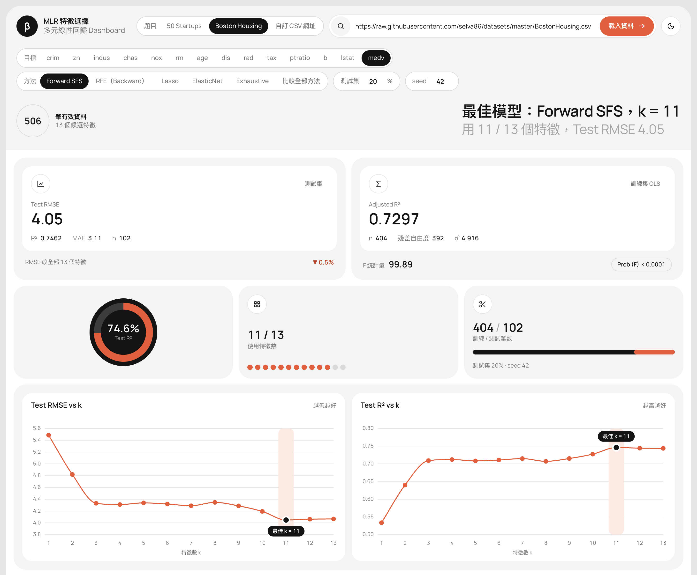
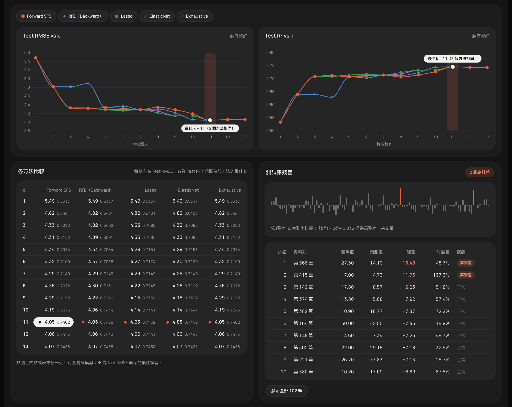
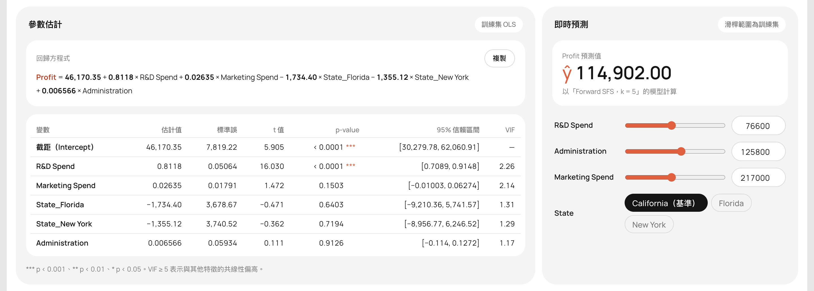

# AIoT-DIC2-MultipleLR

多元線性回歸特徵選擇 Dashboard：比較五種特徵選擇方法在不同特徵數 k 下的測試集表現，並給出最佳模型的係數推論、殘差分析與即時預測。

- **課程名稱**：AIoT 與數據分析（AIoT & Data Analytics, AIoT-DA）
- **上課作業**：DIC2-多元線性回歸 50-startup and boston housing
- **儲存庫網址**：https://github.com/anjyuelee/AIoT-DIC2-MultipleLR
- **線上網址**：https://anjyuelee.github.io/AIoT-DIC2-MultipleLR/



## 作業內容

用 50 Startups 與 Boston Housing 兩份資料做多元線性回歸。每種特徵選擇方法都會為 k = 1..p 各挑出一組特徵，以 OLS 擬合後比較測試集的 RMSE、R² 與 MAE，找出最佳的特徵組合。所有計算都在瀏覽器完成，沒有後端。

## 資料集

| 題目 | 筆數 | 原始欄位 | 候選特徵 | 預測目標 | 資料來源 |
|---|---|---|---|---|---|
| 50 Startups | 50 | R&D Spend、Administration、Marketing Spend、State | 5（State 轉成 State_Florida、State_New York，以 California 為基準） | `Profit`（利潤） | [Avik-Jain/100-Days-Of-ML-Code](https://raw.githubusercontent.com/Avik-Jain/100-Days-Of-ML-Code/master/datasets/50_Startups.csv) |
| Boston Housing | 506 | crim、zn、indus、chas、nox、rm、age、dis、rad、tax、ptratio、b、lstat | 13 | `medv`（房價中位數，千美元） | [selva86/datasets](https://raw.githubusercontent.com/selva86/datasets/master/BostonHousing.csv) |

## 分析流程（CRISP-DM）

1. **商業理解**：確立預測目標與成功標準，測試集 RMSE 越低越好。
2. **資料理解**：讀取 CSV，檢視筆數、欄位型別與缺值。
3. **資料準備**：略過含缺值的列；類別欄依字母排序後 one-hot 並丟掉第一個類別（drop first，同 pandas `get_dummies(drop_first=True)`）；以固定 seed 洗牌後切出測試集，測試筆數無條件進位（同 scikit-learn）。
4. **建模**：只用訓練集做特徵選擇，產生 k = 1..p 的特徵子集，各自以 OLS（含截距）擬合。
5. **評估**：比較測試集 RMSE、R²、MAE，並檢查係數顯著性、VIF 與測試集殘差。
6. **部署**：以純前端靜態網頁發布在 GitHub Pages，用即時預測器套用模型。

## 特徵選擇方法

| 方法 | 做法 |
|---|---|
| Forward SFS | 從只有截距開始，每一步加入讓訓練集 RSS 最小的特徵 |
| RFE（Backward） | 從全部特徵開始，每次刪掉標準化係數絕對值最小的特徵 |
| Lasso | X、y 標準化後沿 L1 正則化路徑（λ 由大到小），依特徵第一次出現非零係數的順序排名，取前 k 個 |
| ElasticNet | 同 Lasso，改用 `l1_ratio = 0.5` 的正則化路徑 |
| Exhaustive | 對每個 k 窮舉全部 C(p, k) 種組合，取訓練集 RSS 最小者；候選特徵超過 15 個時停用 |

特徵選擇只看訓練集，測試集只用來評估，避免資料洩漏。每個方法的最佳模型是 Test RMSE 最低者，同分時取較小的 k。

## 結果（測試集 20%、seed 42）

### 50 Startups

- 訓練 40 筆、測試 10 筆。
- 五種方法的最佳模型都是 **k = 2**：R&D Spend、Marketing Spend。
- Test RMSE 9,304.12、R² 0.9464、MAE 7,736.85；訓練集 Adjusted R² 0.9477、F 354.50。
- 用全部 5 個特徵時 Test RMSE 為 9,668.04，只用 2 個特徵反而更好；再加入 State 或 Administration 都會讓 Test RMSE 變高。

```
Profit = 46,173.60 + 0.8145 × R&D Spend + 0.02474 × Marketing Spend
```

### Boston Housing

- 訓練 404 筆、測試 102 筆。
- 五種方法的最佳模型都是 **k = 11**，也就是去掉 indus 與 age。
- Test RMSE 4.05、R² 0.7462、MAE 3.11；訓練集 Adjusted R² 0.7297、F 99.89。
- 用全部 13 個特徵時 Test RMSE 為 4.07。
- 方法之間的差異出現在特徵數少的時候，例如 k = 3 時 RFE 選 rm、dis、lstat（RMSE 4.82），其他方法都選 rm、ptratio、lstat（RMSE 4.33）。

```
medv = 37.00 − 0.1004 × crim + 0.04195 × zn + 2.837 × chas − 20.46 × nox + 3.979 × rm − 1.597 × dis
       + 0.3013 × rad − 0.01081 × tax − 0.9440 × ptratio + 0.01007 × b − 0.5448 × lstat
```

切分用的是自己實作的 mulberry32 + Fisher–Yates 洗牌，和 scikit-learn 的 `random_state` 不同，所以數字不能直接和 Python notebook 的結果對照。

## 頁面功能

- **設定列**：題目、預測目標與特徵選擇方法都以膠囊按鈕攤開，點一下就切換；也可以貼上自訂 CSV 網址，調整測試集比例與亂數種子。
- **指標卡**：Test RMSE、R²、MAE 與全部特徵模型的差距；訓練集 Adjusted R²、殘差自由度、σ̂、F 檢定；R² 環圈圖、特徵使用數與訓練/測試切分。
- **圖表**：Test RMSE vs k 與 Test R² vs k 左右並排，標出最佳 k，點選圖上的點即可切換模型。
- **特徵矩陣**：每個 k 選到哪些特徵、和前一個 k 相比新加入哪個特徵。
- **比較全部方法**：五種方法畫在同一張圖上，以顏色加標記形狀區分，可個別隱藏；表格列出每個方法在每個 k 的 RMSE 與 R²。
- **參數估計**：係數、標準誤、t、p 值、95% 信賴區間與 VIF（同 statsmodels `OLS`），回歸式可一鍵複製。
- **即時預測**：數值欄用滑桿、類別欄用膠囊按鈕輸入，立即算出預測值，超出訓練範圍時提示外插。
- **測試集殘差**：殘差條碼圖與排序表，|殘差| > 2σ̂ 標為高殘差。
- **淺色/深色主題**：預設跟隨系統，也可手動切換。

**比較全部方法**（深色主題）：五種方法的 Test RMSE、Test R² 曲線，下方是各方法比較表與測試集殘差。



**參數估計與即時預測**（50 Startups，Forward SFS k = 5）：回歸式、係數推論表，以及數值欄滑桿與 State 膠囊按鈕。



## 本機執行

不需要安裝或建置，在專案目錄啟動任一靜態伺服器即可：

```bash
python3 -m http.server 8765
```

開啟 http://127.0.0.1:8765/ 。也可以直接用瀏覽器打開 `index.html`。

要換成其他資料，可以在頁面上貼 CSV 網址，或在 `config.js` 的 `presets` 新增一筆 `{ name, dataUrl, target, source }`。CSV 必須來自允許跨來源讀取（CORS）的網址，例如 raw.githubusercontent.com。

## 專案結構

| 檔案 | 內容 |
|---|---|
| `config.js` | 預設資料來源、預測目標、測試集比例、亂數種子與題目清單 |
| `regression.js` | 純計算：CSV 解析、one-hot、切分、QR 最小平方、五種特徵選擇方法、統計推論 |
| `app.js` | 介面邏輯：載入資料、圖表、表格、選取連動、即時預測 |
| `index.html`、`style.css` | 頁面結構與樣式 |
| `screenshots/` | README 用的頁面截圖（1440px 寬） |
| `.claude/skills/mlr-feature-selection/SKILL.md` | 完整規格與驗證方式 |

## 技術

- HTML、CSS、原生 JavaScript，沒有建置步驟；圖表用 [Chart.js](https://www.chartjs.org/) 4.4.1，字型為 Manrope。
- 計算結果在相同的訓練/測試切分下，已和 scikit-learn（RFE、`lasso_path`、`enet_path`）與 statsmodels（`OLS`、VIF）比對一致。
- 版面參考 Dribbble 上 QClay 的 [Finance Management Dashboard](https://dribbble.com/shots/23245345-Finance-Management-Dashboard)；功能參考 [50 Startups Multiple Linear Regression Explorer](https://huanchen1107.github.io/AIoT-DIC2-MultipleLR/)。
